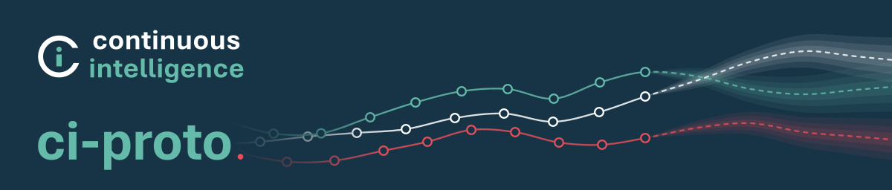

<p>
  <picture>
    <source media="(max-width: 600px)" srcset="https://raw.githubusercontent.com/continuousintelligence/ci/main/assets/readme/header-mobile.svg">
    
  </picture>
</p>

# Introducing ci-proto, our frontier model that says goodbye to context windows and hello to accuracy

**State-of-the-art forecasting at your fingertips.**

- **2M+ context window.** Process 64× the history of any other time-series foundation
  model.
- **Frontier accuracy.** Leading forecasting performance on fev-bench.
- **CPU and GPU support.** Run locally through the same Python API.
- **Multivariate forecasting.** Turn relationships between signals into more accurate
  forecasts.
- **Uncertainty included.** Get nine quantiles between 0.1 and 0.9 to plan for a range of
  outcomes.

**[Make your first forecast](#make-your-first-forecast) ·
[See the results](#frontier-performance) ·
[Join the waitlist for our next release](https://www.continuousintelligence.co.uk/waitlist) ·
[Join our Design Partner Program](https://docs.google.com/forms/d/e/1FAIpQLSdn59prmnz5KpJtVQlyo1FFGLA_YgIB93Z5E5pVIvpTYBnFuw/viewform)**

## Make your first forecast

**Your first forecast in a few lines.** Install with Python 3.10–3.14:

```sh
pip install continuousintelligence
```

Pass a PyTorch tensor, NumPy array, pandas DataFrame, or CSV file to `model.forecast`.
The example below uses the bundled bicycle-rental data from Washington, D.C.,
to forecast the next 24 hours from five days of hourly demand:

```python
import continuousintelligence as ci

# Load the model (uses CUDA when available).
model = ci.load_model("ContinuousIntelligence/ci-proto")

# Load example history as a torch.Tensor shaped [variables, time].
history = ci.load_example()

# Forecast the next 24 hourly time steps.
prediction = model.forecast(history, horizon=24)

# Plot the forecast and its uncertainty bands.
ci.plot_forecast(history, prediction, model.quantiles, output="forecast.png")
```


**The next 24 hours, with uncertainty included.** The shaded region marks the forecast
day. The curve shows the model's median forecast, surrounded by nested quantile bands.
Replace the example history with your own to get started.

Data: Hadi Fanaee-T (2013), [Bike Sharing, UCI](https://doi.org/10.24432/C5W894),
licensed under [CC BY 4.0](https://creativecommons.org/licenses/by/4.0/).

**Dive deeper.** The [walkthrough notebook][walkthrough] extends this example with calendar
covariates, practical uses of the quantiles, and forecasting through missing data.

[walkthrough]: https://github.com/continuousintelligence/ci/blob/main/examples/walkthrough.ipynb

## Frontier performance

**The #1 foundation model on fev-bench.**

[![Mean scaled quantile loss on fev-bench versus parameter count for ci-proto and other
forecasting models. Lower is better.][frontier]][frontier]

[frontier]: https://raw.githubusercontent.com/continuousintelligence/ci/main/assets/readme/ci_proto_pareto_frontier.png

## Talk to the team

**Tell us what you need to predict.** We want to hear about the decisions you're trying to
improve, the data you're working with, and where current methods fall short.

Whether you're exploring a new idea or improving an existing system, we'd like to work
with you on a solution. Share your use case, your constraints, and what success would look
like, and let's discuss how we can help.

**[Join our Design Partner Program](https://docs.google.com/forms/d/e/1FAIpQLSdn59prmnz5KpJtVQlyo1FFGLA_YgIB93Z5E5pVIvpTYBnFuw/viewform)**

## Beyond ci-proto

**Frontier performance is our starting point.** ci-proto gives you a first look at our
approach to time-series intelligence. Our next release builds on that foundation.
Join the waitlist to be the first to hear what's new, see the results, and find out when
you can try it.

**[Join the waitlist](https://www.continuousintelligence.co.uk/waitlist)**

## Usage details

<details>
<summary><strong>Usage details</strong></summary>

### Prepare your history

History is the observed data you want to forecast from. ci-proto works with regularly
sampled data, can forecast multiple variables together, and can handle missing data.
Use `NaN` for missing values. The following formats are supported for the history:

**PyTorch tensors and NumPy arrays** with shape `[variables, time]`: one row per variable,
with observations running from left to right. This example has two variables and four
time steps:

```python
import numpy as np
import torch

values = [[12, 9, 7, 6], [8, 6, 5, 4]]
history = np.array(values)
# Or use a tensor with the same layout.
history = torch.tensor(values, dtype=torch.float32)
```

**pandas DataFrames** with one column per variable and one row per time step. The same
data looks like this:

```python
import pandas as pd

history = pd.DataFrame(
    {
        "store_a": [12, 9, 7, 6],
        "store_b": [8, 6, 5, 4],
    }
)
```

A pandas Series, such as `history["store_a"]`, can be used to forecast a single variable.

**CSV files** with the same layout as a DataFrame. Include a header naming the variables:

```csv
store_a,store_b
12,8
9,6
7,5
6,4
```

Pass the file path as history.

```python
history = "examples/history.csv"
```

### Make a forecast

Once you have your history, load the model and choose how many future steps to predict:

```python
import continuousintelligence as ci

model = ci.load_model("ContinuousIntelligence/ci-proto")
prediction = model.forecast(history, horizon=24)
```

`horizon` can be any positive integer and defaults to 320. For example, when forecasting hourly data, a horizon of
24 predicts the next day. By default, all of the variables are forecast together. If you want independent forecasts, pass each variable in a separate call.

### Read the forecast

ci-proto returns nine quantiles from 0.1 to 0.9. The 0.5 quantile is the median forecast with the other quantiles describing the predicted range of value. All forecast values are `float32` in the original units.

The output depends on the history format. Here, `V` is the number of variables, `T` is
the history length, `H` is the horizon, and `Q` is the number of quantiles.

| History | Returned forecast |
| --- | --- |
| PyTorch tensor | Tensor `[V, Q, H]` on the input tensor's device. |
| NumPy array | Array `[V, Q, H]`. |
| pandas DataFrame, Series, or CSV path | DataFrame with `H` rows and `(variable, quantile)` columns. A Series supplies its name as the variable label. |

To extract the median from a DataFrame forecast or save all quantiles to CSV:

```python
median = prediction.xs(0.5, level="quantile", axis=1)
prediction.to_csv("forecast.csv")
```

</details>

<details>
<summary><strong>Dates and frequency</strong></summary>

Dates are used automatically to provide calendar information, such as the hour and day
of the week.

**PyTorch tensors and NumPy arrays**

Using the tensor or NumPy history from above, supply dates for both the history and
the forecast horizon with `timestamps` and `freq`:

```python
import pandas as pd
import torch

dates = pd.date_range("2026-11-01", periods=history.shape[1] + 24, freq="h")
prediction = model.forecast(
    history,
    horizon=24,
    timestamps=torch.tensor(dates.as_unit("ns").asi8),
    freq="h",
)
```

**pandas DataFrames**

For a DataFrame, you can attach them with a `DatetimeIndex`:

```python
history.index = pd.date_range("2026-11-01", periods=len(history), freq="h")
```

Calendar features use the local time in the index.

**CSV files**

For a CSV file, dates go in a `timestamp` column:

```csv
timestamp,store_a,store_b
2026-11-01T00:00:00,12,8
2026-11-01T01:00:00,9,6
2026-11-01T02:00:00,7,5
2026-11-01T03:00:00,6,4
```

CSV dates are converted to UTC, which is used for calendar features and the forecast
index. Dates without a timezone are treated as UTC.

The [example CSV](examples/history.csv) contains two series with hourly timestamps:

```python
prediction = model.forecast("examples/history.csv", horizon=24)
```

The timestamp arguments use the following shapes, with `T`, `H`, and `V` as defined above:

| Argument | Shape or type | Description |
| --- | --- | --- |
| `timestamps` | `int64` tensor `[T + H]` or `[V, T + H]` | Epoch nanoseconds covering history and horizon, in increasing order. |
| `freq` | String | Sampling frequency, such as `"h"`, `"D"`, or `"W"`. Inferred from dated pandas and CSV inputs when possible. |

For gaps in a regular history, insert the missing time steps and use `NaN` for their values. For uneven histories, left-pad values with `NaN` and timestamps with `torch.iinfo(torch.int64).min`.

</details>

<details>
<summary><strong>Covariates and categorical inputs</strong></summary>

Covariates are extra inputs that can help explain the variables in your history. Past
covariates contain observations available up to the forecast origin. Future covariates
contain values known for both the history and forecast horizon, such as a planned promotion.

Pass them to `model.forecast` as `past_covariates` and `future_covariates`. They accept
the same formats and layouts as history. Align all inputs to the same time axis. Only
the variables in `history` receive forecasts. History also determines the output format
and device.

| Argument | Shape | Requirements |
| --- | --- | --- |
| `past_covariates` | `[past_variables, T]` | Must have exactly the same history length as `history`. |
| `future_covariates` | `[known_variables, T + H]` | Must cover both the observed history and the requested forecast horizon. |
| `categorical_past` | Tuple of variable indices | Selects categorical variables in `past_covariates`; defaults to `()`. |
| `categorical_future` | Tuple of variable indices | Selects categorical variables in `future_covariates`; defaults to `()`. |

A categorical covariate describes a category, such as the type of promotion running in
a store. For example, `0` could mean no promotion, `1` an email campaign, and `2` a discount.
These numbers identify categories rather than quantities.

```python
history = pd.DataFrame({"sales": [12, 9, 7, 6]})
future_covariates = pd.DataFrame({"promotion_type": [0, 0, 1, 2, 1, 0]})
prediction = model.forecast(
    history,
    horizon=2,
    future_covariates=future_covariates,
    categorical_future=(0,),
)
```

The first four rows of `future_covariates` cover the history and the last two cover the
forecast horizon. `categorical_future=(0,)` marks the first covariate as categorical.
Indices refer to tensor/array rows or pandas/CSV columns, starting from zero.
Use `categorical_past` in the same way for past covariates.

Boolean covariates can be supplied as numeric inputs without marking them categorical.
Use `NaN` for missing covariate observations.

</details>

<details>
<summary><strong>Loading models and pinning revisions</strong></summary>

`ci.load_model` accepts a Hugging Face repository ID, a local bundle directory, or a
checkpoint with a separate calibration file.

```python
model = ci.load_model("ContinuousIntelligence/ci-proto", revision="<commit SHA>")
model = ci.load_model("./local/continuousintelligence")
model = ci.load_model("model.ckpt", "tta.json")
```

A bundle contains:

```text
local/continuousintelligence/
├── config.json
├── model.ckpt
├── model-long.ckpt
└── tta.json
```

`model.ckpt` holds the weights and architecture; `tta.json` holds preprocessing and
calibration settings. `model-long.ckpt` is the optional long-history checkpoint; it uses
the same `tta.json` and is loaded on the first forecast above the standard context length.
`config.json` describes the model, with its name, parameter count, quantile levels and
licence, and is checked against the weights when the model loads. `model.info`
returns it. Hugging Face models always include it; local bundles may omit it.

For reproducibility, pin Hugging Face models with a full commit SHA. `revision` applies
only to Hub loading. Use `./` or a `Path` object to identify local paths explicitly.

Histories up to 16,384 observations use the standard checkpoint. Longer histories
automatically use the long checkpoint with the full supplied history.

</details>

<details>
<summary><strong>CPU and GPU setup</strong></summary>

On Linux, a fresh `pip install continuousintelligence` installs CUDA-enabled PyTorch.
`ci.load_model(...)` automatically uses an available CUDA GPU, falling back to CPU.

Python versions 3.10–3.14 are supported. On Linux x86-64, installation includes Mamba-3
kernels and the CUDA 13.0.3 toolchain (`cuda-toolkit[nvcc,cccl]==13.0.3`). Kernels compile
on first use and are cached.

| `device` | Behaviour |
| --- | --- |
| `"auto"` | Uses an available CUDA GPU; otherwise CPU. Default. |
| `"cpu"` | Uses portable PyTorch inference. |
| `"cuda"` | Uses CUDA; raises an error if unavailable. |

Fused inference requires CUDA-enabled PyTorch, an Ampere-or-newer NVIDIA GPU, a
580-series-or-newer driver, and a host C++ compiler. Replace CPU-only PyTorch to enable
GPU inference.

Inference runs on `model.device`. Tensor forecasts return on the input tensor's device,
including its CUDA device index. NumPy and pandas outputs are on the CPU.

`model.backend` is `"mamba3"` for fused CUDA inference or `"torch"` for the portable backend.

Reference results use H100 with PyTorch `2.13.0+cu130`. Reduced-precision results can vary
across runtimes.

</details>

<details>
<summary><strong>Plotting forecasts</strong></summary>

`ci.plot_forecast(history, prediction, quantiles)` accepts tensors: history has shape
`[variables, time]`, predictions `[variables, quantiles, horizon]`, and quantile levels
form a sorted vector including `0.5` for the median.
Each variable gets its own panel with the median and available nested quantile bands.
The function returns a Matplotlib figure; `output` saves it to a file. Pass `timestamps`
covering history plus horizon for a date axis, and `ylabel` to label the values.

`examples/forecast.py` forecasts the bundled bicycle-rental history and saves a plot
with its dates and units.

Run from the repository root:

```sh
pip install .
python examples/forecast.py --model ContinuousIntelligence/ci-proto
```

The plot is saved to `outputs/forecast.png`.

The plotting script reads CSV files using its own column options. Pass `--data` and name
the columns with `--time-column` and `--value-column`. If the file has a `split` column,
rows marked `history` are observed and the following rows marked `forecast` set the horizon.
Otherwise every row is history; pass `--horizon`, and future timestamps continue the
inferred frequency. `--ylabel` sets the axis label.

```sh
python examples/forecast.py --model ContinuousIntelligence/ci-proto \
  --data load.csv --time-column date --value-column load_mw --horizon 48
```

Use `--output` for the figure path and `--device` to select CPU or CUDA. Pin a Hub
revision with `--revision`. Run with `--help` for all options.

</details>

<details>
<summary><strong>Preprocessing and calibration</strong></summary>

Use the checkpoint’s `tta.json`. Preprocessing, test-time augmentation (TTA), and
calibration run automatically without changing model weights.

| Setting | Behaviour |
| --- | --- |
| `postprocess` | Enables differencing, band calibration, quantile sorting, and sign-flip averaging. |
| `tta_diff`, `tta_running_totals` | Control trend and running-total differencing. |
| `tta_sign_flip` | Averages forecasts of the original and negated inputs. |
| `target_encode_categoricals` | Encodes categories using observed target statistics. |
| `clip_nonnegative` | Keeps forecasts nonnegative when the observed history is nonnegative. |
| `integer_round` | Rounds forecasts when the observed history contains only integers. |
| `calendar_covariates` | Adds calendar features from dates and frequency. |
| `bfloat16` | Enables reduced-precision inference; `false` uses float32. |

Edit a local `tta.json` to change these flags. Encoding, clipping, rounding, calendar
features, and precision work independently of `postprocess`.

Keep the supplied numerical constants when reproducing ci-proto results. All configuration
fields are required; missing or unknown fields are rejected.

</details>

## Development

<details>
<summary><strong>Package structure</strong></summary>

Model implementations live in subpackages such as `continuousintelligence.ci_proto`.
The public `continuousintelligence.load_model` entry point, local/Hub file handling
and vendored kernels stay at the package level.

</details>

<details>
<summary><strong>Local setup and tests</strong></summary>

Development requires Python 3.10–3.14 and [uv](https://docs.astral.sh/uv/) 0.11.30 or later.
The repository's `.python-version` selects Python 3.13; CI runs on Python 3.10, 3.13 and 3.14.

From the root of a source checkout, install the locked development dependencies:

```sh
uv sync --locked
```

Development uses the same PyTorch distribution as a normal package install. On Linux
this includes CUDA support; the model automatically selects GPU or CPU at runtime.

Run linting, formatting checks, and the default test suite:

```sh
uv run --locked ruff check .
uv run --locked ruff format --check .
uv run --locked pytest
```

The default tests use small synthetic checkpoints and mock Hub downloads, so ci-proto
weights are not required. They cover model loading, forecasting, covariates, calibration,
and device selection. CUDA tests are skipped when CUDA is unavailable.

To run the additional tests against local ci-proto weights, set both paths:

```sh
CONTINUOUSINTELLIGENCE_CHECKPOINT=./local/continuousintelligence/model.ckpt \
CONTINUOUSINTELLIGENCE_TTA_CONFIG=./local/continuousintelligence/tta.json \
uv run --locked pytest -q
```

Those tests load the supplied checkpoint on CPU and CUDA when available, and check
multivariate forecasts at the default horizon, finite outputs, and quantile ordering.
Without both environment variables, they are skipped.

Model weights, local calibration files, and generated plots are ignored by Git.

</details>

<details>
<summary><strong>Contributing</strong></summary>

Bug reports, feature suggestions, documentation improvements, and code contributions
are welcome.

- **[Report a bug](https://github.com/continuousintelligence/ci/issues).** Include a
  minimal reproducer, expected and actual behaviour, relevant error output, and your
  package, Python, and PyTorch versions. Specify whether you are running on CPU or CUDA.
- **[Suggest a change](https://github.com/continuousintelligence/ci/issues).** Describe
  the use case, the limitation you have encountered, and the behaviour you would like to
  see.
- **[Open a pull request](https://github.com/continuousintelligence/ci/pulls).** Explain
  the problem, the change, and how you verified it. Include a regression test for bug
  fixes and update the documentation when public behaviour changes.

Small, reproducible examples help us investigate issues and review changes. Keep pull
requests focused, and run the checks above before submitting.

</details>

## Licence

The code and model weights are released under the
[ci-proto Code and Model Licence][licence]. Third-party components retain their upstream
licences; see [NOTICE][notice] for attribution and the Apache 2.0 licence text.
The bundled example data is licensed under CC BY 4.0;
see its [notice][data-notice].

[licence]: https://github.com/continuousintelligence/ci/blob/main/LICENCE
[notice]: https://github.com/continuousintelligence/ci/blob/main/NOTICE
[data-notice]: https://github.com/continuousintelligence/ci/blob/main/src/continuousintelligence/_data/NOTICE
